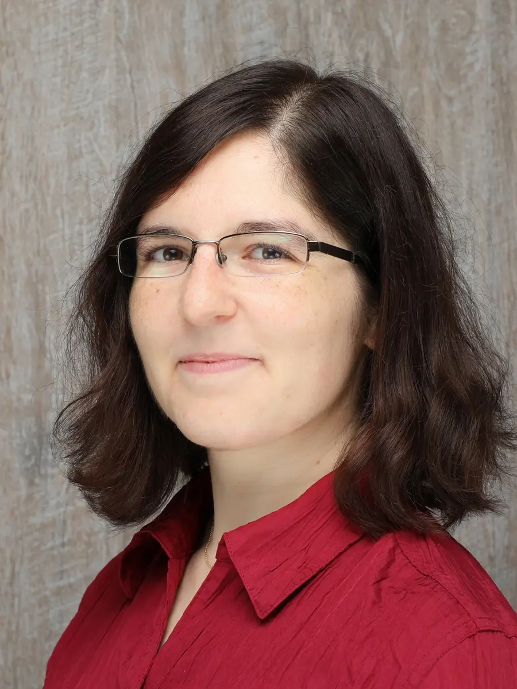
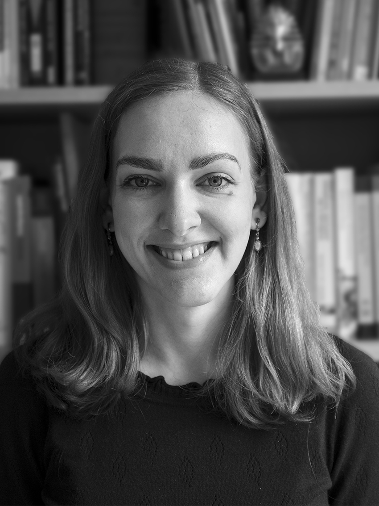
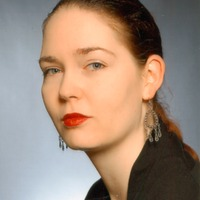
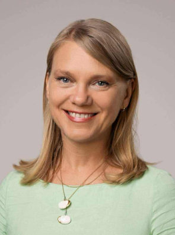
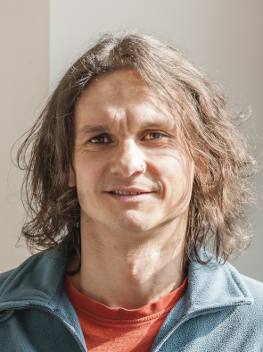

## SprecherInnen

<!--
HINWEIS:
Bei Änderung der SprecherInnen muss auch die Tabelle in `Impressum.qmd > ## Kontakt` manuell aktualisiert werden.
 -->

::: {layout=[-15,70,-15]}

|  |  |  |
|-------------|---------------------------------|--------------------------|
|  | **Jessica Keil** | Universität Innsbruck Institut für Archäologien Innrain 52a (Ágnes-Heller-Haus) A-6020 Innsbruck [jessica.keil\@uibk.ac.at](mailto:jessica.keil@uibk.ac.at) |
|  | **Stefanie Schaefer-di Maida** | Georg-August-Universität Göttingen Seminar für Ur- und Frühgeschichte Nikolausberger Weg 15 D-37073 Göttingen [stefanie.schaefer-dimaida\@uni-goettingen.de](mailto:stefanie.schaefer-dimaida@uni-goettingen.de) |

: {tbl-colwidths=\[20,25,55\]}

:::

## Wissenschaftlicher Beirat

::: {layout=[-15,70,-15]}

|  |  |  |
|-----------------|----------------------------|----------------------------|
|  | **Bianka Nessel** | Johannes Gutenberg-Universität Mainz Vor- und Frühgeschichtliche Archäologie [bnessel\@uni-mainz.de](mailto:bnessel@uni-mainz.de) |
|  | **Dirk Brandherm** | Queen's University Belfast School of Geography, Archaeology & Palaeoecology [d.brandherm\@qub.ac.uk](mailto:d.brandherm@qub.ac.uk) |
|  | **Agnė Čivilytė** | Lithuanian Institute of History Archaeology Department [civilytea\@gmail.com](mailto:civilytea@gmail.com) |
|  | **André Spatzier** | Landesamt für Denkmalpflege Baden-Württemberg im Regierungspräsidium Stuttgart Archäologische Denkmalpflege [andre.spatzier\@rps.bwl.de](mailto:andre.spatzier@rps.bwl.de) |

: {tbl-colwidths=\[20,25,55\]}

:::
## Liste der SprecherInnen und Beiräte

Die folgenden Listen enthalten die gegenwärtigen und – soweit bekannt – ehemaligen SprecherInnen und Beiräte der AG Bronzezeit.

::: {layout-ncol=2}

|     | von | bis |
|-----|-----|-----|
| Stefanie Schaefer-di Maida | 2026 |  |
| Jessica Keil | 2025 |  |
| Tobias Mörtz | 2024 | 2026 |
| Jan Miera | 2023 | 2025 |
| André Spatzier | 2022 | 2024 |
| Katharina Malek-Custodis | 2019 | 2023 |
| Christian Horn | 2018 | 2022 |
| Ken Massy | 2017 | 2019 |
| Jan-Heinrich Bunnefeld | 2016 | 2018 |
| Gisela Woltermann | 2015 | 2017 |
| Daniel Neumann | 2014 | 2016 |
| Bianka Nessel |  |  |
| Dirk Brandherm |  |  |
| Immo Heske |  |  |
| Barbara Horejs |  |  |
| Tobias Kienlin |  |  |
| Stefan Schwenzer |  |  |
| Martin Bartelheim |  |  |
| Frank Falkenstein |  |  |
| Johannes Müller |  |  |

: Liste der SprecherInnen

|     | von | bis |
|-----|-----|-----|
| Agnė Čivilytė | 2025 |  |
| André Spatzier | 2024 |  |
| Bianka Nessel | 2017 |  |
| Dirk Brandherm | 2017 |  |
| Katharina Malek-Custodis | 2024 | 2025 |
| Daniel Neumann | 2017 | 2024 |
| Andy Reymann | 2017 | 2024 |
| Immo Heske |  |  |
| Barbara Horejs |  |  |
| Tobias Kienlin |  |  |
| Stefan Schwenzer |  |  |

: Liste der wissenschaftlichen Beiräte

:::